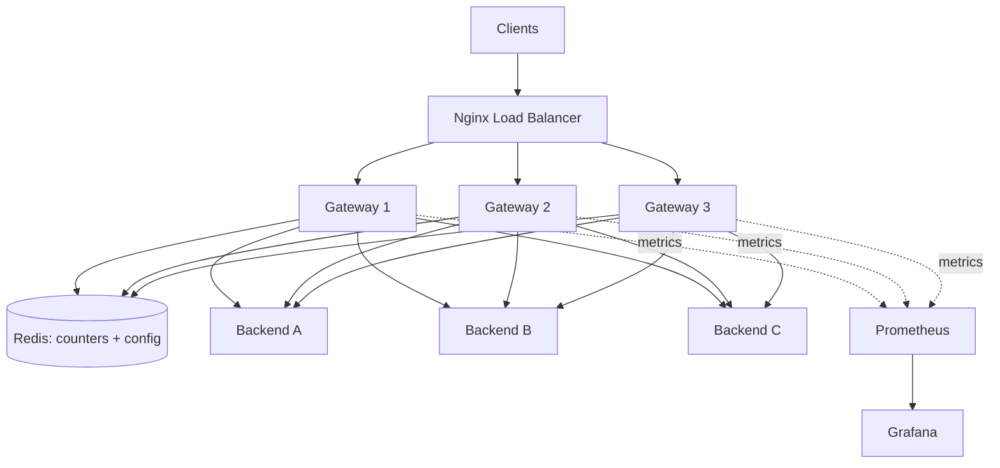

# Distributed Rate Limiter + API Gateway

**Stack:** Java 17+, Spring Boot, Redis (Lua), Resilience4j, Prometheus, Grafana, Docker
**Goal:** A system-design-focused portfolio project for SDE / Backend Engineer roles
**Estimated time:** 4-6 weeks at 2-3 hrs/day (2-3 weeks full-time)

---

## 1. Problem Statement

Backend services can be overloaded or abused by:
- Buggy clients or bots sending thousands of requests per second
- One heavy user starving everyone else
- Brute-force attacks on login or payment APIs
- Free-tier users consuming paid-tier capacity

A **rate-limiting API gateway** sits in front of services and enforces fair usage.

**The hard part:** with multiple gateway instances, in-memory counters don't work. A user limited to 100 req/min could send 300 (100 per instance). Counters must be **shared and atomic** across instances. That is the core system design challenge of this project.

---

## 2. Goals and Non-Goals

### Goals
- Per-user / per-API-key / per-route rate limiting
- Correct behavior across N gateway instances (no race conditions)
- Multiple algorithms, switchable per route
- Runtime config changes without restart
- Fault tolerance (circuit breaker, retries, Redis failure handling)
- Observability (metrics, dashboards)
- Measured performance (benchmarks in README)

### Non-Goals
- Full production auth system (basic API key / JWT is enough)
- Service discovery (Eureka/Consul), static backend list is fine
- Multi-region replication

---

## 3. High-Level Architecture



### Request flow (inside one gateway instance)

```
Request
  -> AuthFilter           (identify client: API key / JWT)
  -> RateLimitFilter      (Redis + Lua, algorithm chosen per route)
  -> ResilienceFilter     (circuit breaker + retry + timeout)
  -> Router               (consistent hashing picks backend)
  -> Backend
```

This is a **Chain of Responsibility**: each filter either passes the request on or short-circuits with a response (401, 429, 503).

### Components

| Component | Responsibility |
|---|---|
| Nginx | Spreads traffic across gateway instances |
| Gateway (Spring Boot) | Auth, rate limiting, resilience, routing |
| Redis | Shared rate limit state + dynamic config + pub/sub |
| Backend services | Simple mock services (can be tiny Spring apps) |
| Prometheus | Scrapes `/actuator/prometheus` from each gateway |
| Grafana | Dashboards for allowed/blocked, latency, breaker state |

---

## 4. Rate Limiting Algorithms

All implement one interface (**Strategy pattern**):

```java
public interface RateLimiter {
    RateLimitResult tryAcquire(String key, RateLimitConfig config);
}

public record RateLimitResult(boolean allowed, long remaining, long retryAfterMs) {}
```

| Algorithm | How it works | Pros | Cons |
|---|---|---|---|
| **Token Bucket** | Bucket refills at fixed rate; each request takes a token | Allows bursts, O(1) memory | Burst can surprise strict limits |
| **Sliding Window Log** | Stores timestamp of every request in a sorted set | Most accurate | High memory (one entry per request) |
| **Sliding Window Counter** | Weighted blend of current + previous fixed window | Good accuracy, low memory | Approximate |
| *(Bonus)* Fixed Window | Counter per time window | Simplest | Boundary burst problem (2x limit) |

### Why Lua scripts?
A naive flow (`GET` count, check, `INCR`) has a **race condition** between instances. Redis executes a Lua script **atomically**, so read-check-update happens as one operation.

### Token bucket Lua (starter)

```lua
-- KEYS[1] = bucket key
-- ARGV[1] = capacity, ARGV[2] = refill rate (tokens/sec)
-- ARGV[3] = now (ms), ARGV[4] = tokens requested
local data = redis.call('HMGET', KEYS[1], 'tokens', 'ts')
local tokens = tonumber(data[1])
local ts = tonumber(data[2])
local capacity = tonumber(ARGV[1])
local rate = tonumber(ARGV[2])
local now = tonumber(ARGV[3])
local requested = tonumber(ARGV[4])

if tokens == nil then
  tokens = capacity
  ts = now
end

local elapsed = math.max(0, now - ts)
tokens = math.min(capacity, tokens + (elapsed / 1000) * rate)

local allowed = 0
if tokens >= requested then
  tokens = tokens - requested
  allowed = 1
end

redis.call('HMSET', KEYS[1], 'tokens', tokens, 'ts', now)
redis.call('PEXPIRE', KEYS[1], math.ceil((capacity / rate) * 1000) * 2)
return { allowed, math.floor(tokens) }
```

> Tip: use Redis `TIME` inside the script instead of the client clock to avoid clock skew between gateway instances.

---

## 5. Key Design Decisions (put these in your design doc)

### 5.1 What if Redis goes down?
| Option | Behavior | Trade-off |
|---|---|---|
| **Fail-open** | Allow all requests | Availability preserved, protection lost |
| **Fail-closed** | Block all requests | Safe for backend, outage for users |
| **Local fallback** | In-memory limiter per instance | Approximate limits, best of both |

**Recommended:** fail-open with a local in-memory fallback limiter (e.g., limit divided by instance count) plus an alert metric.

### 5.2 Why Redis?
Sub-millisecond latency, atomic Lua scripting, native TTL for auto-cleanup, pub/sub for config propagation. Alternatives: Hazelcast, DB (too slow), local-only (inconsistent).

### 5.3 Rate limit key design
`rl:{route}:{clientId}` e.g. `rl:/orders:user_42`
Consider also: per-IP limits for unauthenticated routes, tiered limits (free vs premium).

### 5.4 Redis single point of failure
Mention Redis Sentinel / Cluster as the production answer. For the project, document it and optionally run Redis with a replica.

### 5.5 Hot keys
One very heavy client hammers a single Redis key. Mitigation: cluster sharding by key hash, local pre-check, or batching tokens locally.

### 5.6 Consistency vs performance
Each request costs one Redis round trip. Optional optimization: local token batching (fetch 10 tokens at a time). Trade-off: slightly looser limits for lower latency. Benchmark both.

---

## 6. Resilience

- **Circuit breaker** (Resilience4j): CLOSED -> OPEN after failure threshold -> HALF_OPEN probes -> CLOSED
- **Retries** with exponential backoff + jitter, only for idempotent requests (GET)
- **Timeouts** on every downstream call
- **Bulkhead** (optional): cap concurrent calls per backend
- **Fallback response:** return 503 with `Retry-After` header

---

## 7. Load Balancing: Consistent Hashing

Backends are placed on a hash ring using **virtual nodes** (e.g., 100-200 per backend). A request key (client ID) hashes to a point and goes to the next node clockwise.

**Why:** adding or removing a backend remaps only ~1/N keys instead of nearly all (as with `hash % N`).

Implement from scratch with `TreeMap<Long, Backend>` and `ceilingEntry()`. Skip backends whose circuit breaker is open.

---

## 8. Dynamic Configuration

Config example (stored in Redis, editable via API):

```json
{
  "route": "/orders",
  "algorithm": "TOKEN_BUCKET",
  "capacity": 100,
  "refillPerSecond": 10,
  "tiers": { "free": 50, "premium": 500 }
}
```

**Admin API**
| Method | Endpoint | Purpose |
|---|---|---|
| GET | `/admin/routes` | List route configs |
| PUT | `/admin/routes/{id}` | Update limits / algorithm |
| POST | `/admin/routes` | Add route |
| DELETE | `/admin/routes/{id}` | Remove route |

On update: write to Redis, publish on a pub/sub channel, every instance refreshes its local cache. No restart needed.

---

## 9. Response Contract

On allowed requests, add headers:
```
X-RateLimit-Limit: 100
X-RateLimit-Remaining: 73
```
On blocked requests:
```
HTTP 429 Too Many Requests
Retry-After: 12
```

---

## 10. Observability

**Metrics (Micrometer -> Prometheus)**
- `gateway_requests_total{route, status}`
- `gateway_rate_limited_total{route, algorithm}`
- `gateway_request_duration_seconds` (histogram, p50/p95/p99)
- `gateway_redis_latency_seconds`
- `gateway_circuit_breaker_state{backend}`
- `gateway_redis_fallback_total`

**Grafana dashboard panels:** req/s, blocked %, p95/p99 latency, breaker states, Redis latency.

Also add: structured logs with a correlation ID per request.

---

## 11. Project Structure

```
rate-limiter-gateway/
├── gateway/
│   └── src/main/java/com/you/gateway/
│       ├── GatewayApplication.java
│       ├── filter/
│       │   ├── AuthFilter.java
│       │   ├── RateLimitFilter.java
│       │   └── ResilienceFilter.java
│       ├── limiter/
│       │   ├── RateLimiter.java              (interface)
│       │   ├── TokenBucketLimiter.java
│       │   ├── SlidingWindowLogLimiter.java
│       │   ├── SlidingWindowCounterLimiter.java
│       │   ├── RateLimiterFactory.java
│       │   └── LocalFallbackLimiter.java
│       ├── routing/
│       │   ├── ConsistentHashRing.java
│       │   └── BackendRouter.java
│       ├── config/
│       │   ├── RouteConfig.java
│       │   ├── DynamicConfigService.java
│       │   └── ConfigRefreshListener.java
│       ├── admin/AdminController.java
│       └── metrics/MetricsConfig.java
├── gateway/src/main/resources/lua/
│   ├── token_bucket.lua
│   ├── sliding_window_log.lua
│   └── sliding_window_counter.lua
├── mock-backend/                              (tiny Spring Boot app)
├── nginx/nginx.conf
├── monitoring/
│   ├── prometheus.yml
│   └── grafana-dashboard.json
├── loadtest/
│   └── k6-script.js
├── docs/
│   ├── architecture.png
│   └── design-doc.md
└── docker-compose.yml
```

---

## 12. Design Patterns Used

| Pattern | Where |
|---|---|
| Strategy | Rate limiting algorithms |
| Chain of Responsibility | Gateway filter pipeline |
| Factory | `RateLimiterFactory` picks algorithm from config |
| Observer / Pub-Sub | Config refresh across instances |
| Circuit Breaker | Downstream failure isolation |
| Consistent Hashing | Backend selection |

---

## 13. Implementation Roadmap

### Phase 1: Core limiter in plain Java (Days 1-4)
- [ ] Define `RateLimiter` interface
- [ ] Implement in-memory `TokenBucketLimiter` (thread-safe: `synchronized` / `AtomicLong` / CAS)
- [ ] Unit tests: refill, burst, concurrency (use `ExecutorService` with 100 threads)
- [ ] **Learn:** race conditions, `ConcurrentHashMap`, atomicity

### Phase 2: Spring Boot gateway (Days 5-9)
- [ ] Spring Boot project, mock backend service
- [ ] Filter chain: Auth -> RateLimit -> Router
- [ ] Basic reverse proxy (`WebClient` or `RestClient`)
- [ ] Return 429 + headers

### Phase 3: Distributed state with Redis (Days 10-16)
- [ ] Redis + Spring Data Redis / Lettuce
- [ ] Token bucket Lua script, execute via `RedisScript`
- [ ] Multi-instance test: run 3 instances, prove limits hold globally
- [ ] Add sliding window log + sliding window counter
- [ ] `RateLimiterFactory`

### Phase 4: Dynamic config (Days 17-20)
- [ ] Config model + Redis storage
- [ ] Admin REST API
- [ ] Pub/sub refresh + local cache
- [ ] Tiered limits (free / premium)

### Phase 5: Resilience and routing (Days 21-26)
- [ ] Resilience4j circuit breaker, retry, timeout
- [ ] Consistent hash ring with virtual nodes (with unit tests for distribution + remap %)
- [ ] Redis failure handling: fail-open + local fallback

### Phase 6: Observability and Docker (Days 27-32)
- [ ] Micrometer metrics + `/actuator/prometheus`
- [ ] Prometheus + Grafana config, dashboard JSON
- [ ] Dockerfiles + `docker-compose.yml` (3 gateways, Nginx, Redis, 3 backends, Prometheus, Grafana)

### Phase 7: Testing, benchmarks, docs (Days 33-42)
- [ ] Integration tests with Testcontainers (Redis)
- [ ] k6 load tests: baseline, burst, Redis-down, backend-down
- [ ] Compare algorithms: latency, memory, accuracy
- [ ] Write design doc, architecture diagram, README
- [ ] Optional: blog post

---

## 14. Testing Strategy

| Type | What to test |
|---|---|
| Unit | Each algorithm: refill, expiry, edge cases, concurrency |
| Unit | Consistent hash: even distribution, minimal remap on node change |
| Integration | Lua scripts against real Redis (Testcontainers) |
| Distributed | 3 instances, N clients, assert total allowed <= limit |
| Chaos | Kill Redis, kill backend, verify fail-open + breaker behavior |
| Load | k6: sustained, spike, and soak tests |

---

## 15. Docker Compose (sketch)

```yaml
services:
  nginx:
    image: nginx:alpine
    ports: ["8080:80"]
    volumes: ["./nginx/nginx.conf:/etc/nginx/nginx.conf"]
    depends_on: [gateway1, gateway2, gateway3]

  gateway1: &gateway
    build: ./gateway
    environment:
      - REDIS_HOST=redis
      - INSTANCE_ID=gw1
    depends_on: [redis]
  gateway2:
    <<: *gateway
    environment: [REDIS_HOST=redis, INSTANCE_ID=gw2]
  gateway3:
    <<: *gateway
    environment: [REDIS_HOST=redis, INSTANCE_ID=gw3]

  redis:
    image: redis:7-alpine

  backend-a: { build: ./mock-backend }
  backend-b: { build: ./mock-backend }
  backend-c: { build: ./mock-backend }

  prometheus:
    image: prom/prometheus
    volumes: ["./monitoring/prometheus.yml:/etc/prometheus/prometheus.yml"]
    ports: ["9090:9090"]

  grafana:
    image: grafana/grafana
    ports: ["3000:3000"]
```

---

## 16. Benchmarks to Publish

Create a table in your README like this (fill with your real numbers):

| Scenario | Throughput | p50 | p95 | p99 | Notes |
|---|---|---|---|---|---|
| Gateway only (no limiter) | ? req/s | ? ms | ? ms | ? ms | Baseline |
| Token bucket + Redis | ? | ? | ? | ? | |
| Sliding window log | ? | ? | ? | ? | Higher memory |
| Sliding window counter | ? | ? | ? | ? | |
| Redis down (fail-open) | ? | ? | ? | ? | |

Also report: accuracy test (limit 100, how many actually passed under 3 instances), and Redis memory per 100k keys per algorithm.

---

## 17. README Checklist (what recruiters look for)

- [ ] One-paragraph "what and why"
- [ ] Architecture diagram
- [ ] Quick start: `docker-compose up` and a sample `curl`
- [ ] Algorithm comparison table
- [ ] Benchmark results with graphs
- [ ] Design decisions and trade-offs (link to design doc)
- [ ] "What I'd do next" (Redis Cluster, multi-region, WebSocket support)
- [ ] Screenshot of the Grafana dashboard

---

## 18. Interview Talking Points

1. **Why not in-memory counters?** Multi-instance inconsistency.
2. **Why Lua?** Atomic read-modify-write, avoids race conditions.
3. **Token bucket vs sliding window?** Burst tolerance vs accuracy vs memory.
4. **Redis down?** Fail-open + local fallback, with reasoning.
5. **Why consistent hashing?** Minimal remapping when backends change.
6. **How do you scale it?** Stateless gateways scale horizontally; Redis scales via Cluster sharding by key.
7. **Hot key problem?** Local token batching, sharding.
8. **How do you know it works?** Distributed tests, chaos tests, benchmarks.
9. **Clock skew?** Use Redis server time inside Lua.
10. **What would you improve?** Redis Cluster, per-tenant quotas, adaptive limits, distributed tracing.

---

## 19. Stretch Goals

- Redis Cluster / Sentinel setup
- Distributed tracing (OpenTelemetry + Jaeger)
- Adaptive rate limiting (lower limits when backend latency rises)
- Request queueing / priority lanes
- Simple admin UI
- gRPC support
- Deploy to Kubernetes with HPA

---

## 20. Fallback Projects (if this feels too big)

- Distributed job scheduler (mini Quartz)
- Real-time notification system with Kafka
- Mini key-value store with replication

---

## 21. Weekly Milestone Summary

| Week | Deliverable |
|---|---|
| 1 | Thread-safe token bucket + tests, Spring Boot gateway skeleton |
| 2 | Redis + Lua, 3 algorithms working across instances |
| 3 | Dynamic config API, circuit breaker, retries |
| 4 | Consistent hashing, metrics, Grafana dashboards |
| 5 | Docker Compose, load tests, benchmarks |
| 6 | Design doc, diagrams, README, blog post |

**Rule:** always keep a working version. Build a minimal end-to-end (token bucket + Redis + Docker) by end of week 2, then add features one at a time.
